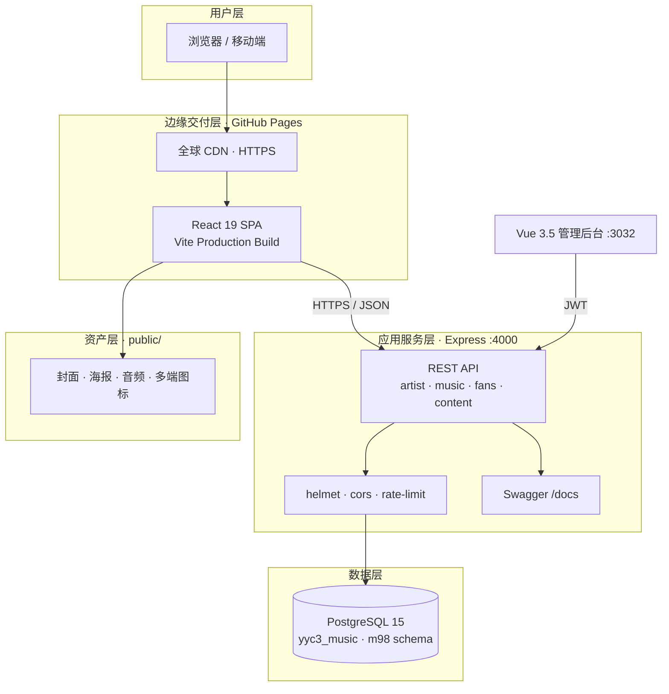
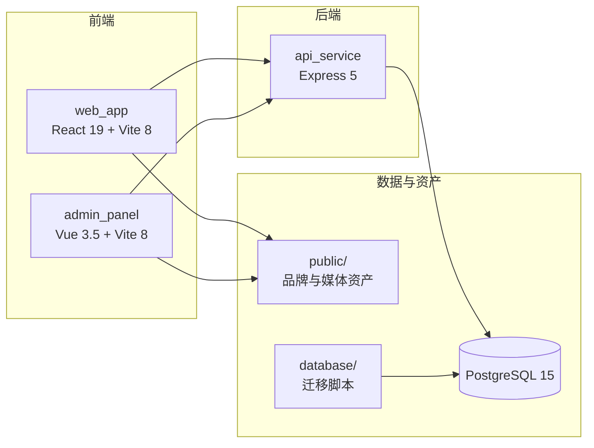
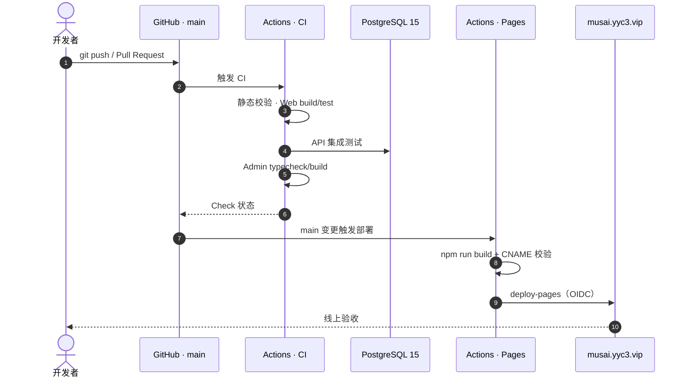

<p align="center">
  
</p>

<p align="center">
  
</p>

<h1 align="center">M98 董小姐音乐宇宙</h1>

<p align="center">
  <b>电子 × 东方 × 未来</b><br>
  <i>Electronic × Oriental × Future</i>
</p>

<p align="center">
  一个以「东方电子音乐」为灵魂、以数字空间为载体的音乐人生态：<b>可看、可听、可互动、可度量、可演进</b>。
</p>

<p align="center">
  <a href="https://github.com/YYC-Cube/YYC3-Dong-MusAI/actions/workflows/ci.yml"></a>
  <a href="https://github.com/YYC-Cube/YYC3-Dong-MusAI/actions/workflows/deploy-pages.yml"></a>
  <a href="https://musai.yyc3.vip"></a>
  <a href="./LICENSE"></a>
  <a href="./CHANGELOG.md"></a>
</p>

<p align="center">
  <a href="https://nodejs.org/"></a>
  <a href="https://react.dev/"></a>
  <a href="https://vite.dev/"></a>
  <a href="https://expressjs.com/"></a>
  <a href="https://www.postgresql.org/"></a>
  <a href="https://docs.github.com/pages"></a>
</p>

<p align="center">
  <a href="./docs/README.md"></a>
  <a href="./CONTRIBUTING.md"></a>
  <a href="./CODE_OF_CONDUCT.md"></a>
  <a href="./SECURITY.md"></a>
  <a href="https://github.com/YYC-Cube/YYC3-Dong-MusAI/commits/main"></a>
</p>

<p align="center">
  <a href="#-在线体验">在线体验</a> ·
  <a href="#-核心能力">核心能力</a> ·
  <a href="#-可视化架构">可视化架构</a> ·
  <a href="#-快速开始">快速开始</a> ·
  <a href="#-部署与-cicd">部署与 CI/CD</a> ·
  <a href="#-文档矩阵">文档矩阵</a> ·
  <a href="#-贡献与治理">贡献与治理</a>
</p>

---

> **_YYC³_**（YanYuCloudCube™ · 注册商标）
> _言启象限 | 语枢未来_
> **_Words Initiate Quadrants, Language Serves as Core for Future_**
> _万象归元于云枢 | 深栈智启新纪元_
> **_All things converge in cloud pivot; Deep stacks ignite a new era of intelligence_**

**五高架构**：高可用 | 高性能 | 高安全 | 高扩展 | 高智能
**五标体系**：标准化 | 规范化 | 自动化 | 可视化 | 智能化
**五化转型**：流程化 | 数字化 | 生态化 | 工具化 | 服务化
**五维评估**：时间维 | 空间维 | 属性维 | 事件维 | 关联维

---

## 🌐 在线体验

| 入口 | 地址 | 说明 |
| ---- | ---- | ---- |
| 官方网站 | [https://musai.yyc3.vip](https://musai.yyc3.vip) | GitHub Pages · 自定义域名 · HTTPS |
| 代码仓库 | [YYC-Cube/YYC3-Dong-MusAI](https://github.com/YYC-Cube/YYC3-Dong-MusAI) | 主仓库 · `main` 为生产分支 |
| CI 流水线 | [Actions · CI](https://github.com/YYC-Cube/YYC3-Dong-MusAI/actions/workflows/ci.yml) | 静态校验 · 构建 · 测试 |
| 部署流水线 | [Actions · Deploy Pages](https://github.com/YYC-Cube/YYC3-Dong-MusAI/actions/workflows/deploy-pages.yml) | `web_app` → Pages |
| 安全扫描 | [Actions · CodeQL](https://github.com/YYC-Cube/YYC3-Dong-MusAI/actions/workflows/codeql.yml) | JavaScript / TypeScript |

> Pages 仅承载 `web_app` 静态前端；`api_service` 需独立部署，前端通过 `REACT_APP_API_BASE_URL` 指向 API 地址。
>
> 未配置 API 地址或 API 不可达时，首页自动回退到 [`web_app/src/config/fallbackData.js`](./web_app/src/config/fallbackData.js) 的本地静态数据，保证静态站点可独立浏览。

---

## 一句话画像

| 属性 | 内容 |
| ---- | ---- |
| 项目名 | M98 董小姐音乐宇宙（M98_DongXiaoJie） |
| 仓库名 | `YYC3-Dong-MusAI` |
| 艺人 | 董小姐（艺名 M98） |
| 定位 | 音乐人官网 + 粉丝社区 + 数据洞察 + AI 创作展示 |
| 技术栈 | React 19 · Vite 8 · Vue 3.5 · Express 5 · PostgreSQL 15 · Docker |
| 数据源 | 主库 `yyc3_music`（PG15，`yanyu@localhost:5433` 本机免密，NAS Docker `yyc3-music`） |
| 交付形态 | GitHub Pages 静态站 + 可独立部署的全栈服务 |
| 品牌主色 | `#8A2BE2` 紫罗兰 × `#FF6B6B` 珊瑚红 × `#0D1117` 深空黑 |

**核心标签**：`东方电子` `音乐人生态` `粉丝互动` `React 19` `Vite 8` `Express 5` `PostgreSQL` `GitHub Pages` `YYC³`

---

## ✨ 核心能力

| 模块 | 能力 | 状态 |
| ---- | ---- | :--: |
| 艺术家主页 | 资料、哲学语录、统计、社交入口 | ✅ |
| 音乐作品 | 11 首曲库、作品卡片、本地封面 | ✅ |
| 播放器 | 真实音频、播放/暂停、切歌、进度、音量 | ✅ |
| 粉丝互动 | 留言墙、点赞 | 🟡 |
| 独家内容 | 幕后、试听、锁定权益 | 🟡 |
| 虚拟演出 | VR / 直播 / 音乐节 | 🟡 |
| 数据看板 | 听众、播放、收入示意 | 🟡 |
| 社交聚合 | 微博 / 抖音 / B站 / 小红书 | 🟡 |
| 管理后台 | 登录、JWT 鉴权、总览看板（Vue 3.5 + Vite 8 + TS 5.9） | 🟡 MVP |
| 移动端 | iOS / Android | ⬜ 规划中 |
| AI 创作 | 歌词 / 旋律生成 | 🟡 展示层 |
| 天气 MCP | Python MCP 2.x 助手 | ✅ 独立 |

---

## 🏗 可视化架构

> GitHub 原生渲染 Mermaid，可直接缩放、拖拽与查看节点详情。

### 系统分层



### 模块依赖



<details>
<summary><b>展开 · CI/CD 时序（push → 测试 → Pages → 线上）</b></summary>



</details>

### 目录结构

```text
YYC3-Dong-MusAI/
├── .github/          CI · Pages · CodeQL · Dependabot · Issue/PR 模板
├── web_app/          React 19 + Vite 8 粉丝网站（Pages 部署对象）
├── api_service/      Express API（PostgreSQL 唯一入口）
├── content_db/       开发数据库与种子数据
├── database/         PostgreSQL 迁移脚本 + SQLite 迁移源（归档）
├── admin_panel/      Vue 3.5 + Vite 8 管理后台（登录 + 总览 MVP）
├── mobile_app/       移动端（规划中）
├── marketing_tools/  营销自动化（规划中）
├── weather/          Python MCP 天气助手
├── scripts/          启动 / 测试 / 数据库脚本
├── public/           品牌、封面、海报、音乐、多端图标（唯一事实源）
├── brand_assets/     品牌指南
└── docs/             十二阶段文档体系
```

---

## 🚀 快速开始

### 环境要求

- Node.js ≥ 20.19（推荐 22 LTS）
- npm ≥ 9
- PostgreSQL 15（`yyc3_music`，端口 `5433`；NAS Docker `yyc3-music`）

### 克隆与安装

```bash
git clone https://github.com/YYC-Cube/YYC3-Dong-MusAI.git
cd YYC3-Dong-MusAI

# 1. 后端（PostgreSQL 默认入口）
cd api_service
npm install
npm run pg:migrate
npm run pg:import
npm start

# 2. 前端（另开终端）
cd web_app
npm install
npm start

# 3. 管理后台（另开终端）
cd admin_panel
npm install
npm run dev

# 4. 访问
# Web       http://localhost:3000
# Admin     http://localhost:3032
# API       http://localhost:4000
# API Docs  http://localhost:4000/docs
# Health    http://localhost:4000/health
```

> 管理后台开发默认账号：`admin` / `m98-admin-dev`，生产必须通过 `ADMIN_USERNAME` / `ADMIN_PASSWORD` 覆盖。
>
> 历史 Mongo / SQLite / Mock 服务入口已下线；`pg:import` 与 `pg:verify` 仍可读取归档 SQLite 作为一次性迁移源。

> 数据源已确认迁移至 **PostgreSQL 15**（`yyc3_music` / NAS `yyc3-music`），连接参数见 [开发环境指南](./docs/03-YYC3-项目开发-实施阶段/0302-YYC3-项目开发-开发环境指南.md)；音乐 API 远程通道为 `ssh yyc3-45`。

### 数据库迁移

```bash
cd api_service
npm run pg:migrate      # 建立 m98 schema 与表结构
npm run pg:import       # 归档 SQLite → PostgreSQL 幂等导入
npm run pg:seed:content # 写入独家内容 / 博客 / 活动
npm run pg:verify       # 行数与播放量校验
```

> 环境变量见 [0502-环境变量手册](./docs/05-YYC3-项目部署-文档闭环/0502-YYC3-项目部署-环境变量手册.md)，迁移细节见 [0503-PostgreSQL 适配与迁移指南](./docs/05-YYC3-项目部署-文档闭环/0503-YYC3-项目部署-PostgreSQL适配与迁移指南.md)。

### 一键脚本

```bash
./scripts/start_dev.sh
./scripts/stop_dev.sh
./scripts/test_api.sh
```

> 完整环境说明见 [开发环境指南](./docs/03-YYC3-项目开发-实施阶段/0302-YYC3-项目开发-开发环境指南.md)。

---

## 🚢 部署与 CI/CD

### GitHub Pages（前端）

| 项 | 值 |
| ---- | ---- |
| 线上域名 | [https://musai.yyc3.vip](https://musai.yyc3.vip) |
| 自定义域名 | `public/CNAME` → `musai.yyc3.vip` |
| 部署方式 | GitHub Actions · `deploy-pages.yml`（`build_type: workflow`） |
| 构建目录 | `web_app/build` |
| 触发条件 | `main` 分支变更 `web_app/**`、`public/**` 或部署工作流 |
| HTTPS | 已启用并强制跳转 |

发布链路：`push main` → CI 校验 → Pages 构建（资产 + CNAME 同步）→ 上传产物 → `deploy-pages` 发布 → 域名验收。

### 自托管全栈

```bash
docker compose up -d --build
```

> 容器编排、Nginx、备份与回滚见 [0501-部署运维指南](./docs/05-YYC3-项目部署-文档闭环/0501-YYC3-项目部署-部署运维指南.md)。
> Pages 与 CI 的完整操作手册见 [0504-GitHub Pages 与 CI/CD 指南](./docs/05-YYC3-项目部署-文档闭环/0504-YYC3-项目部署-GitHubPages与CI-CD指南.md)。

### 流水线清单

| 工作流 | 触发 | 内容 | 权限 |
| ---- | ---- | ---- | ---- |
| `ci.yml` | push / PR（main、develop） | 静态校验、Web 构建与测试、API 集成测试、Admin 构建 | `contents: read` |
| `deploy-pages.yml` | push main / 手动 | Pages 构建、CNAME 校验、OIDC 发布 | `pages: write`、`id-token: write` |
| `codeql.yml` | push / PR / 每周 | JavaScript / TypeScript 安全扫描 | `security-events: write` |
| `dependabot.yml` | 每周 | npm 三端 + GitHub Actions 依赖更新 | — |

---

## 🎨 资产体系

所有品牌、视觉与音频资产统一存放在 `public/`，代码侧通过 [`web_app/src/config/assets.js`](./web_app/src/config/assets.js) 引用。

| 资产 | 预览 | 路径 |
| ---- | ---- | ---- |
| 品牌主图 |  | `public/D-MusAI.png` |
| Logo |  | `public/D-Music-icons/logo.svg` |
| 封面（8） |  | `public/D-cover/` |
| 海报（6） |  | `public/D-poster/` |
| 音乐（11） | 🎵 | `public/D-Music/` |
| 多端图标 |  | `public/D-Music-icons/` |

**曲库**

| # | 曲目 | 艺人 |
| :-: | ---- | ---- |
| 01 | 奉陪 | 董小姐 & 沫言 |
| 02 | 时光 | 董小姐 & 沫言 |
| 03 | 浮生如渡 | 董小姐 & 沫言 |
| 04 | 渡心时序 | 董小姐 & 沫言 |
| 05 | 岁月如歌 | 董小姐 & 沫言 |
| 06 | 岁月如歌 | 董小姐 |
| 07 | 我是渡船也是过客 | 董小姐 |
| 08 | 我的宝贝 | 董小姐 |
| 09 | 秋风不问梧桐意 | 董小姐 |
| 10 | 过客 | 董小姐 |
| 11 | 除了你 | 董小姐 |

> 引用规范见 [资源引用规范](./docs/08-YYC3-项目整合-实施阶段/0801-YYC3-项目整合-资源引用规范.md)，资产登记见 [媒体资产清单](./docs/09-YYC3-项目资产-知识管理/0901-YYC3-项目资产-媒体资产清单.md)。

> **资产同步**：Vite 服务 `web_app/public`，`npm start` / `npm run build` 会通过 `prestart` / `prebuild` 自动执行 `scripts/sync-assets.js`，把根 `public/` 的白名单资产（含 `CNAME`）同步过去；也可手动执行 `npm run sync:assets`。

---

## 📚 文档矩阵

### 十二阶段文档

| 阶段 | 文档 | 说明 |
| ---- | ---- | ---- |
| 00 总览 | [项目总览手册](./docs/00-YYC3-项目总览-目录索引/001-YYC3-项目总览-项目总览手册.md) | 画像与导航 |
| 01 规划 | [项目章程与愿景](./docs/01-YYC3-项目规划-启动阶段/0101-YYC3-项目规划-项目章程与愿景.md) | 目标与治理 |
| 02 设计 | [系统架构设计](./docs/02-YYC3-项目规划-设计阶段/0201-YYC3-项目规划-系统架构设计.md) | 分层与契约 |
| 03 开发 | [功能实现清单](./docs/03-YYC3-项目开发-实施阶段/0301-YYC3-项目开发-功能实现清单.md) · [开发环境指南](./docs/03-YYC3-项目开发-实施阶段/0302-YYC3-项目开发-开发环境指南.md) | 实现与环境 |
| 04 测试 | [全维度调研报告](./docs/04-YYC3-项目测试-审核阶段/0401-YYC3-项目测试-全维度调研报告.md) · [测试方案与用例](./docs/04-YYC3-项目测试-审核阶段/0402-YYC3-项目测试-测试方案与用例.md) | 诊断与用例 |
| 05 部署 | [部署运维指南](./docs/05-YYC3-项目部署-文档闭环/0501-YYC3-项目部署-部署运维指南.md) · [GitHub Pages 与 CI/CD](./docs/05-YYC3-项目部署-文档闭环/0504-YYC3-项目部署-GitHubPages与CI-CD指南.md) | 发布与回滚 |
| 06 运营 | [协作对接指引](./docs/06-YYC3-项目运营-维护阶段/0601-YYC3-项目运营-协作对接指引.md) | RACI 与流程 |
| 07 合规 | [安全审计报告](./docs/07-YYC3-项目合规-安全保障/0701-YYC3-项目合规-安全审计报告.md) | 风险与整改 |
| 08 整合 | [资源引用规范](./docs/08-YYC3-项目整合-实施阶段/0801-YYC3-项目整合-资源引用规范.md) | 资产唯一入口 |
| 09 资产 | [媒体资产清单](./docs/09-YYC3-项目资产-知识管理/0901-YYC3-项目资产-媒体资产清单.md) | 全量登记 |
| 10 模版 | [文档模版与落地规范](./docs/10-YYC3-项目模版-标准规范/1001-YYC3-项目模版-文档模版与落地规范.md) | 标规落地 |
| 11 演进 | [技术债与演进路线](./docs/11-YYC3-智能演进-优化阶段/1101-YYC3-智能演进-技术债与演进路线.md) | 债务与路线 |
| 12 指南 | [用户操作手册](./docs/12-YYC3-用户指南-操作手册/1201-YYC3-用户指南-用户操作手册.md) | 使用说明 |

完整索引：[docs/README.md](./docs/README.md)

### 开发者文档

| 文件 | 内容 |
| ---- | ---- |
| [CONTRIBUTING.md](./CONTRIBUTING.md) | 贡献流程、分支规范、提交规范、测试与 PR 清单 |
| [CODE_OF_CONDUCT.md](./CODE_OF_CONDUCT.md) | 社区行为准则与执行机制 |
| [SECURITY.md](./SECURITY.md) | 漏洞报告、响应时限与安全基线 |
| [CHANGELOG.md](./CHANGELOG.md) | 版本变更记录（Keep a Changelog） |
| [LICENSE](./LICENSE) | MIT（仅代码） |
| [.github/](./.github/) | CI、Pages、CodeQL、Dependabot、Issue/PR 模板 |

---

## 🧪 质量与测试

| 检查 | 执行方式 | 状态 |
| ---- | ---- | :--: |
| 静态校验（JSON / API 语法 / CNAME） | `ci.yml · static` | ✅ |
| 前端生产构建（Vite 8） | `ci.yml · web` | ✅ |
| 前端单元测试（Vitest 5） | `web_app/npm test` | ✅ |
| 后端单元/接口测试（2 suites / 17 tests） | `api_service/npm test` | ✅ |
| PG API 冒烟（10 读 + 写 + 边界） | `api_service/npm test` | ✅ |
| 管理后台类型检查与构建 | `ci.yml · admin` | ✅ |
| 多视口 UI 审计（1440 / 1024 / 390） | Playwright | ✅ |
| CodeQL 安全扫描 | `codeql.yml` | ✅ |
| 依赖漏洞扫描 | Dependabot + `npm audit` | 🟡 |
| E2E / 性能 / 兼容性 | 待接入 | ⏸ |

```bash
# 本地静态检查
find api_service/src -type f -name "*.js" -exec node --check {} \;
grep -rn "/assets/" web_app/src || echo "资源引用通过"

# 前端构建与测试（Vite 8 + Vitest 5）
cd web_app && npm run build && npm test

# 后端测试（需 PostgreSQL 15）
cd api_service && npm test
```

测试方案与通过标准：[测试方案与用例](./docs/04-YYC3-项目测试-审核阶段/0402-YYC3-项目测试-测试方案与用例.md)

---

## 🗺 路线图

| 阶段 | 目标 | 状态 |
| ---- | ---- | :--: |
| M0 | 基线冻结（Git / 文档 / 远程仓库） | ✅ |
| M1 | 止血（P0 修复 / 资源接线 / 密钥治理） | ✅ |
| M2 | 工程化（Vite 8 / React 19 / Vitest / CI / Pages / Docker） | ✅ |
| M3 | 体验完善（响应式已完成；空态 / 无障碍待推进） | 🟡 |
| M4 | 生态扩展（后台 / 移动端 / AI 服务） | ⬜ |

详见 [技术债与演进路线](./docs/11-YYC3-智能演进-优化阶段/1101-YYC3-智能演进-技术债与演进路线.md)。

---

## 🤝 贡献与治理

### 提交规范

```text
<type>(<scope>): <subject>
类型：feat | fix | docs | style | refactor | perf | test | build | ci | chore
示例：feat(player): 接入本地曲库真实音频播放
```

### 分支模型

```text
main        生产（受保护，CI + 评审后合并）
develop     开发
feature/*   功能
fix/*       缺陷
docs/*      文档
refactor/*  重构
hotfix/*    热修
release/*   发布
```

### 合并门禁

- `ci.yml` 全部 Job 通过
- 至少 1 名评审人批准
- 无密钥、Token、真实用户数据
- 文档与 Swagger 已同步
- 破坏性变更标注 `BREAKING CHANGE`

详见 [CONTRIBUTING.md](./CONTRIBUTING.md)、[CODE_OF_CONDUCT.md](./CODE_OF_CONDUCT.md) 与 [SECURITY.md](./SECURITY.md)。

---

## 🏷 仓库标签 / 关键词

**GitHub Topics（建议并已同步）**

```text
yyc3  m98  dongxiaojie  music  music-platform  fan-platform
react  vite  express  postgresql  github-pages  ci-cd  open-source
ai-music  eastern-electronic  yyc3-standard
```

**About 描述**

```text
M98 董小姐音乐宇宙 · 东方电子音乐人生态 | React 19 + Vite 8 + Express 5 + PostgreSQL 15 | GitHub Pages: https://musai.yyc3.vip
```

**同步命令**

```bash
gh api -X PUT repos/YYC-Cube/YYC3-Dong-MusAI/topics \
  -f "names[]=yyc3" \
  -f "names[]=m98" \
  -f "names[]=dongxiaojie" \
  -f "names[]=music" \
  -f "names[]=music-platform" \
  -f "names[]=fan-platform" \
  -f "names[]=react" \
  -f "names[]=vite" \
  -f "names[]=express" \
  -f "names[]=postgresql" \
  -f "names[]=github-pages" \
  -f "names[]=ci-cd" \
  -f "names[]=open-source" \
  -f "names[]=ai-music" \
  -f "names[]=eastern-electronic" \
  -f "names[]=yyc3-standard"
```

**文档关键词**：言启象限 · 语枢未来 · 万象归元于云枢 · 深栈智启新纪元 · 五高五标五化五维 · 东方电子音乐 · 音乐人生态

---

## ⚖️ 版权与许可

- **源代码**：MIT License，© 2026 YanYuCloudCube™（YYC³）。
- **媒体资产**：`public/D-Music/`、`public/D-cover/`、`public/D-poster/`、`public/D-Music-icons/` 等音乐、图像与图标版权归**董小姐及品牌方**所有，**不适用 MIT**，未经书面授权不得复制、再分发或商用。
- 详见 [LICENSE](./LICENSE) 与 [SECURITY.md](./SECURITY.md)。

---

## 📮 联系

| 渠道 | 地址 |
| ---- | ---- |
| 团队邮箱 | [admin@0379.email](mailto:admin@0379.email) |
| 安全问题 | [SECURITY.md](./SECURITY.md) · [私密漏洞报告](https://github.com/YYC-Cube/YYC3-Dong-MusAI/security/advisories/new) |
| 文档入口 | [docs/README.md](./docs/README.md) |
| 线上站点 | [https://musai.yyc3.vip](https://musai.yyc3.vip) |

---

<p align="center">
  <b>YYC³</b>（YanYuCloudCube™ · 注册商标）<br>
  言启象限 | 语枢未来<br>
  <i>Words Initiate Quadrants, Language Serves as Core for Future</i><br>
  万象归元于云枢 | 深栈智启新纪元<br>
  <i>All things converge in cloud pivot; Deep stacks ignite a new era of intelligence</i><br>
  <sub>© 2026 YanYuCloudCube™（YYC³）· <a href="mailto:admin@0379.email">admin@0379.email</a></sub>
</p>
